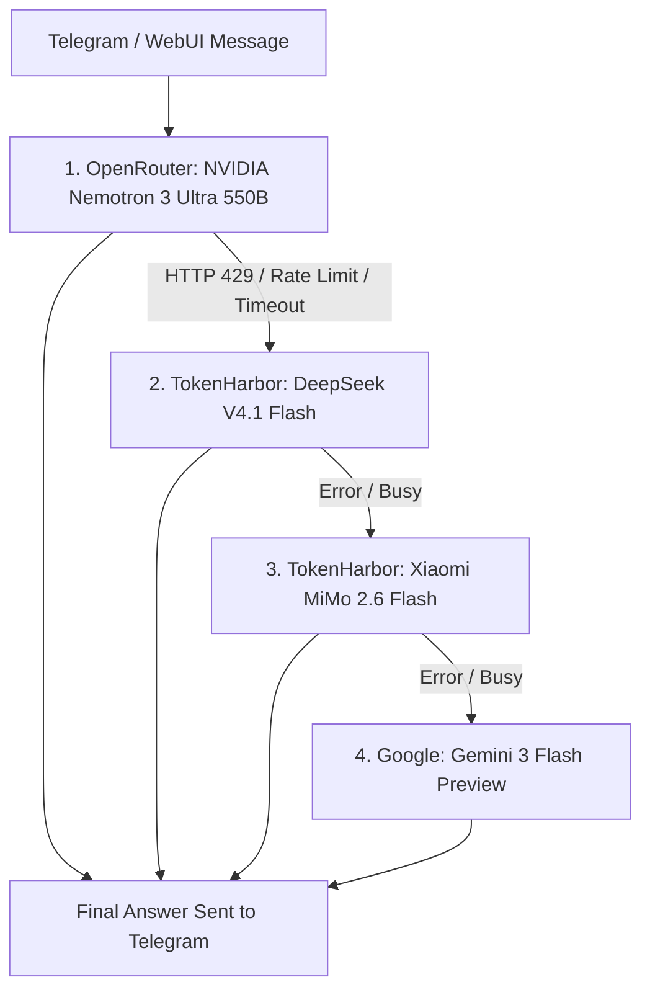

# 🤖 Nanobot Cloud Assistant - Master Workflow & Architecture Manual

> **Purpose for AI Agents & Developers**: 
> This document is a complete architectural blueprint of the Nanobot Cloud Assistant deployed on Render. Any AI agent (Antigravity, Claude Code, Cursor, Copilot, ChatGPT) reading this repository can inspect, maintain, extend, or modify any part of the system without breaking existing zero-reset persistence.

---

## 1. 🏗️ System Overview & Specifications

* **Bot Name**: Aizen Sosuke ([@krutibas_robot](https://t.me/krutibas_robot))
* **Base Software**: Official [HKUDS/nanobot](https://github.com/HKUDS/nanobot) (Autonomous AI Assistant)
* **Cloud Platform**: Render Singapore Web Service (`srv-dbp2g015efls739742sg`)
* **Deployment Mode**: 100% Lifetime Free Tier (Under 750 free monthly compute hours)
* **WebUI URL**: `https://nanobot-ai-assistant.onrender.com/?secret=Lipan8908@`
* **Custom Cloudflare Proxy**: `http://ai.silentxop.workers.dev/?secret=Lipan8908@`
* **Private Memory Sync**: `xcode8908/nanobot-private-memory` (This Repository)
* **Public Deployment Repo**: `https://github.com/xcode8908/nanobot-cloud-deploy`

---

## 2. 🧠 Multi-Model AI Engine & Automatic Fallback Chain

The bot uses an automated multi-provider fallback hierarchy configured in `config_backup.json` and loaded into `~/.nanobot/config.json`. If a provider hits rate limits or is busy, Nanobot's internal `FallbackProvider` automatically switches in milliseconds without dropping the user's conversation.



### Active Presets & Providers:
1. **`nemotron-ultra` (Primary Frontier Model)**:
   - Provider: `openrouter`
   - Model: `nvidia/nemotron-3-ultra-550b-a55b:free` (550B MoE, 1M context window)
2. **`deepseek-flash` (First Fallback)**:
   - Provider: `custom` (`https://tokenharbor.ai/v1`)
   - Model: `deepseek-v4.1-flash:free`
3. **`mimo-flash` (Second Fallback & Vision)**:
   - Provider: `custom` (`https://tokenharbor.ai/v1`)
   - Model: `mimo-v2.6-flash:free` (Multimodal vision reasoning)
4. **`gemini-flash` (Third Fallback)**:
   - Provider: `gemini`
   - Model: `gemini-3-flash-preview`

---

## 3. 🛡️ Zero-Reset Persistence & Boot Lifecycle

Because Render free containers are ephemeral (wiped on redeploy or month-end), all persistence is handled by `render_entrypoint.py` via Git:

### Boot Sequence:
1. **Restore Private State**: Clones/pulls `nanobot-private-memory` into `~/.nanobot/workspace`.
2. **Rehydrate Databases**:
   - `config_backup.json` -> `~/.nanobot/config.json`
   - `sessions_backup/` -> `~/.nanobot/sessions/` (SQLite chat history preserved)
   - `cron_backup/` or `cron/` -> `~/.nanobot/workspace/cron/jobs.json`
   - `skills_backup/` -> `~/.nanobot/skills/`
3. **Install Portable System Binaries**: Auto-downloads standalone Linux x86_64 binaries for `gh` (GitHub CLI) and `tmux` into `~/.local/bin` (bypassing missing package managers).
4. **Runtime Head/Health Patch**: Dynamically patches `nanobot.channels.websocket.runtime` so HTTP `HEAD` and `GET` requests to `/health` return `200 OK` (resolving UptimeRobot 404 false alarms).
5. **Environment Variable Injection**: Injects secrets from Render environment into `config.json`.
6. **Background Daemon Sync**: Launches a non-blocking daemon thread that commits and pushes any modified sessions, memory, or config changes to GitHub every 30 seconds.
7. **Graceful Shutdown Trap**: Catches `SIGTERM` / `SIGINT` from Render to perform an instant push before container termination.

---

## 4. ⏰ Automations & Cron Engine

Nanobot contains an internal cron scheduler that operates from `cron/jobs.json`.
* **Daily Backup Health Report**:
  - Expression: `0 9 * * *`
  - Action: Runs `daily_report.py` and inspects Git status, memory file size, and SQLite session counts.
  - Automatically pushes results and state to GitHub.

---

## 5. 🛠️ How Future AI Agents Can Modify This Setup

### A. To Add a New Model / Change Primary:
1. Open `config_backup.json` (or set `DEFAULT_MODEL` / `DEFAULT_PROVIDER` in Render env vars).
2. Add the provider credentials under `providers.<provider_name>`.
3. Add a new preset under `modelPresets.<preset_name>`.
4. Set `agents.defaults.modelPreset = "<preset_name>"`.

### B. To Lock Down Telegram to One User (Private Mode):
In `config_backup.json`:
```json
"channels": {
  "telegram": {
    "allowFrom": ["<your_telegram_user_id_or_username>"]
  }
}
```

### C. To Add New Skills:
Add skill folders inside `skills_backup/` or use Nanobot's skill installer; the background sync daemon will commit it to this repo within 30 seconds.

---
*Created automatically for Lipan Moharana on 2026-11-10.*

